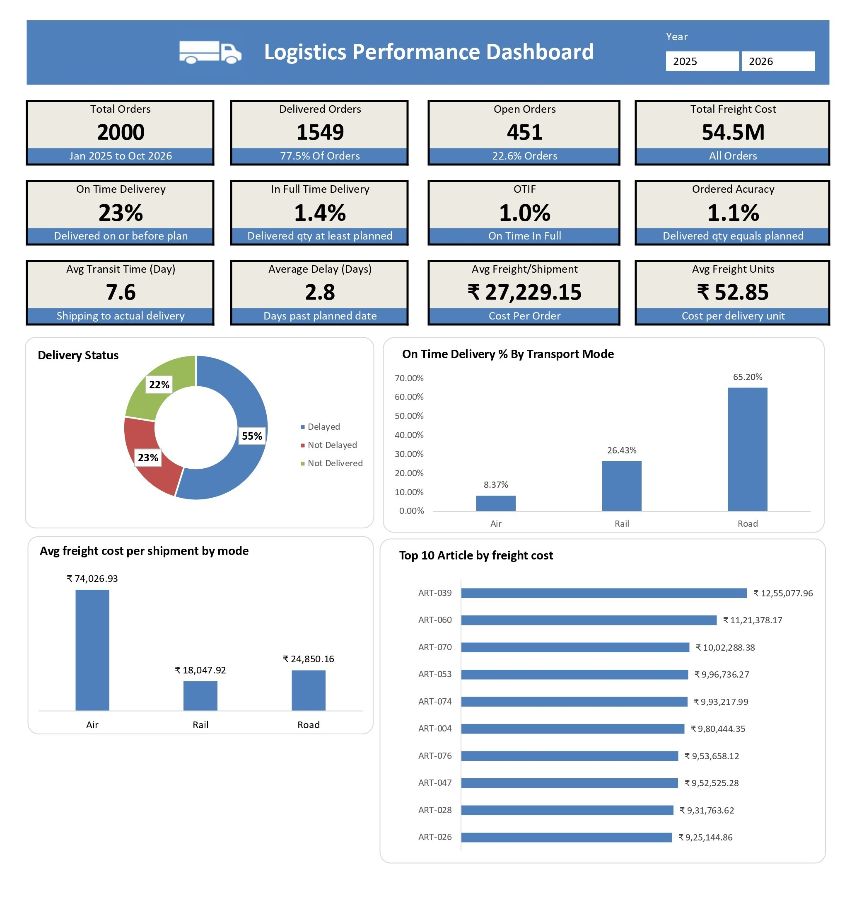
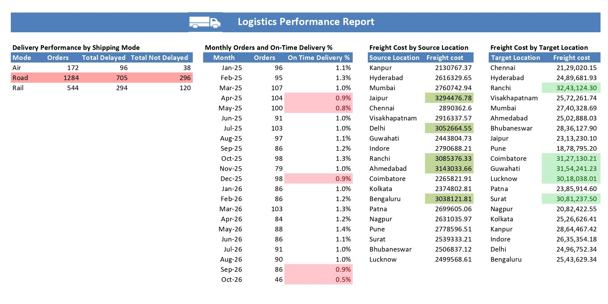

# Logistics Performance Analysis

#### **About the Project**

This project is an interactive dashboard that tracks how deliveries are working. I analyze  2,000 orders from Jan 2025 to Oct 2026 and shows delivery speed, accuracy, and freight cost in one place. A year filter at the top lets you view the data for a chosen year.

#### **Objective**

To identify where deliveries are late, where freight costs are high, and what to fix first.

#### **What the dashboard shows**

- Order summary: Total Orders (2,000), Delivered Orders (1,549), Open Orders (451), and Total Freight Cost (54.5M).
- Delivery performance: On-Time Delivery (23%), In-Full Delivery (1.4%), OTIF (1.0%), and Order Accuracy (1.1%).
- Transit and cost: Average Transit Time (7.6 days), Average Delay (2.8 days), Average Freight per Shipment (₹27,229), and Average Freight per Unit (₹52.85).
- Charts: Delivery Status, On-Time Delivery % by Transport Mode, Average Freight Cost by Mode, and Top 10 Articles by Freight Cost.

  

#### Key Findings

- Only 23% of orders arrive on time, while 55% are delayed and 22% are not delivered.
- Air is the most expensive mode at ₹74,026 per shipment, and it has the lowest on-time rate of just 8.37%.
- Road gives the best on-time rate at 65.28% with a low cost of ₹24,850 per shipment.
- Rail has a 26.43% on-time rate and the lowest cost at ₹18,047 per shipment.
- OTIF is only 1.0%, In-Full is 1.4%, and Order Accuracy is 1.1%, so these need urgent attention.
- Average delay is 2.8 days, and average transit time is 7.6 days.
- Top article ART-039 has a freight cost of ₹12.55 lakh, and the top 10 articles are all above ₹9 lakh.
- Open orders are 451 (22.6%), and delivered orders are 1,549 (77.5%).

**What the report shows**

- Delivery Performance by Shipping Mode: Orders, Total Delayed, and Total Not Delayed for Air, Road, and Rail.
- Monthly Orders and On-Time Delivery %: Orders and on-time delivery rate for each month from Jan-25 to Oct-26.
- Freight Cost by Source Location: Total freight cost for each of the 15 source cities.
- Freight Cost by Target Location: Total freight cost for each of the 15 destination cities.

**Key Findings**

- Road has the most delays: 705 of its 1,284 orders are delayed.
- Rail also struggles, with 294 of 544 orders delayed.
- Air has 96 of 172 orders delayed, despite being the costliest mode.
- On-time delivery stays very low every month, between 0.5% and 1.4%.
- Oct-26 has the worst on-time rate at just 0.5%.
- Apr-25, May-25, Dec-25, and Sep-26 are also weak, at 0.8% to 0.9%.
- Freight cost is high in a few locations: Jaipur (₹32.94 lakh) as a source and Ranchi (₹32.43 lakh) as a target.

#### Recommendation

- Helps cut freight cost by choosing the right transport mode.
- Helps improve on-time and complete deliveries.
- Fix Road delays first, as it has the most delayed orders (705).
- Check the on-time delivery formula, as 0.5% to 1.4% looks too low.
- Negotiate rates for high-cost locations like Jaipur and Ranchi.

**Skills Used**

Data cleaning, KPI creation, data visualization, dashboard design, and business analysis.
